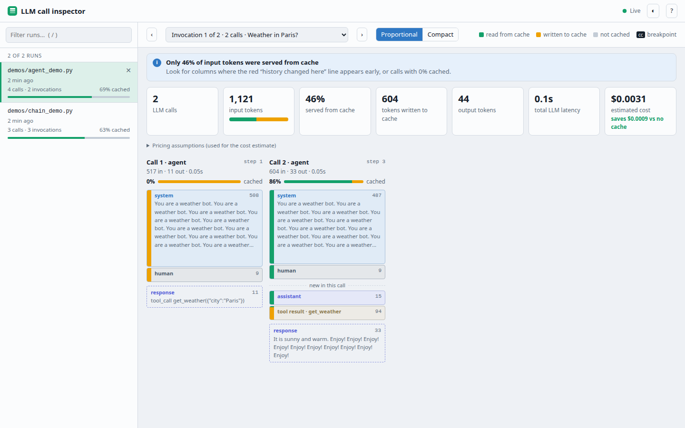
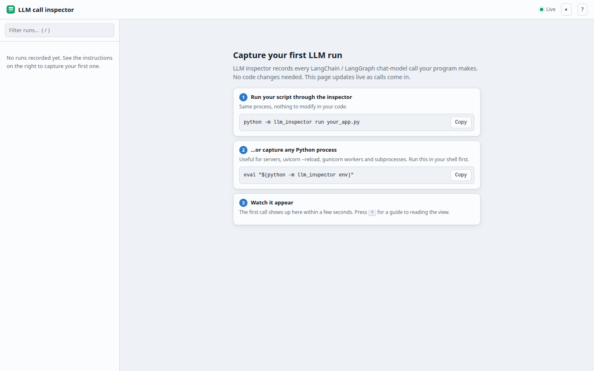
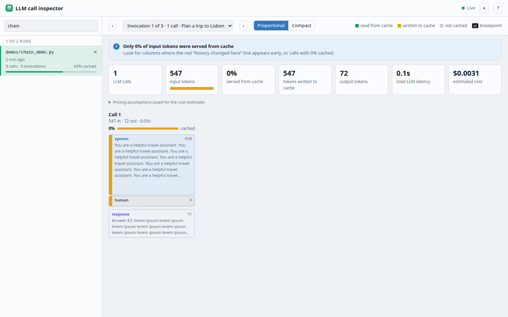
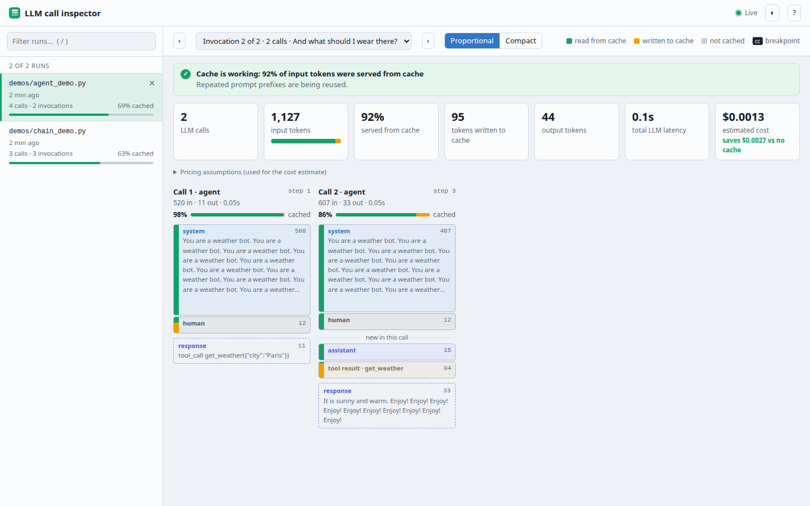
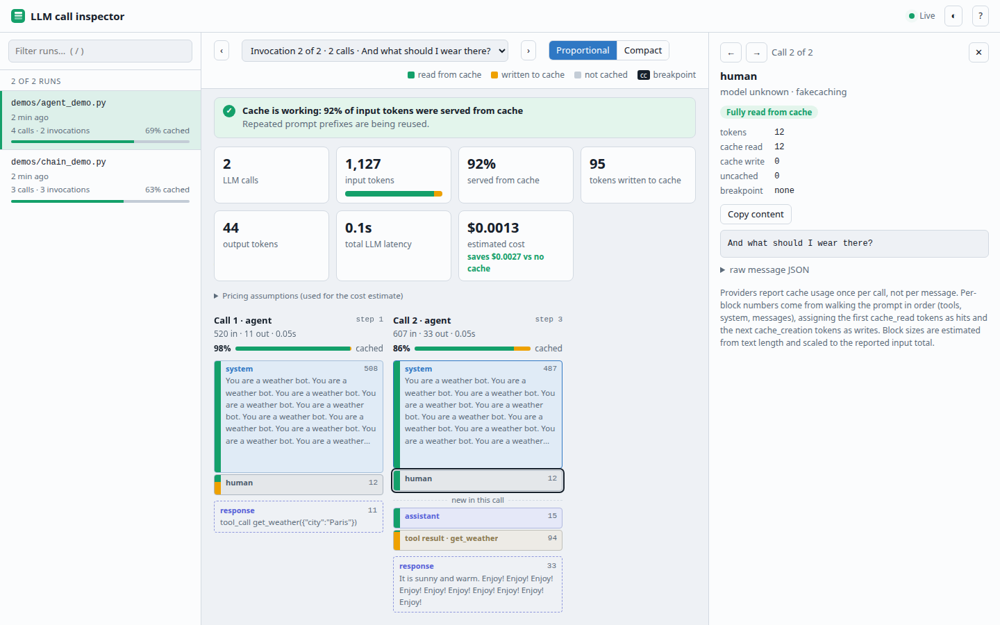
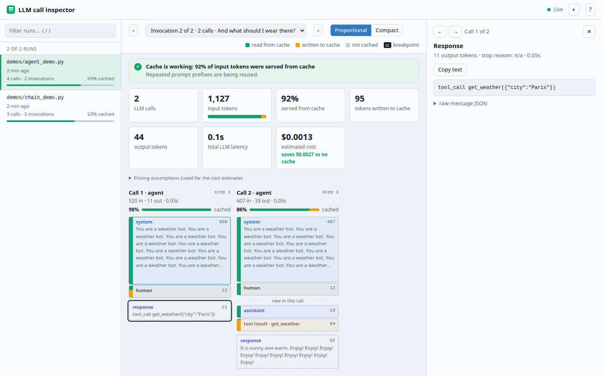
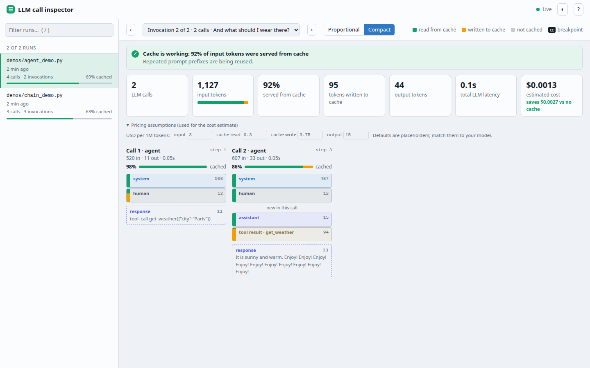
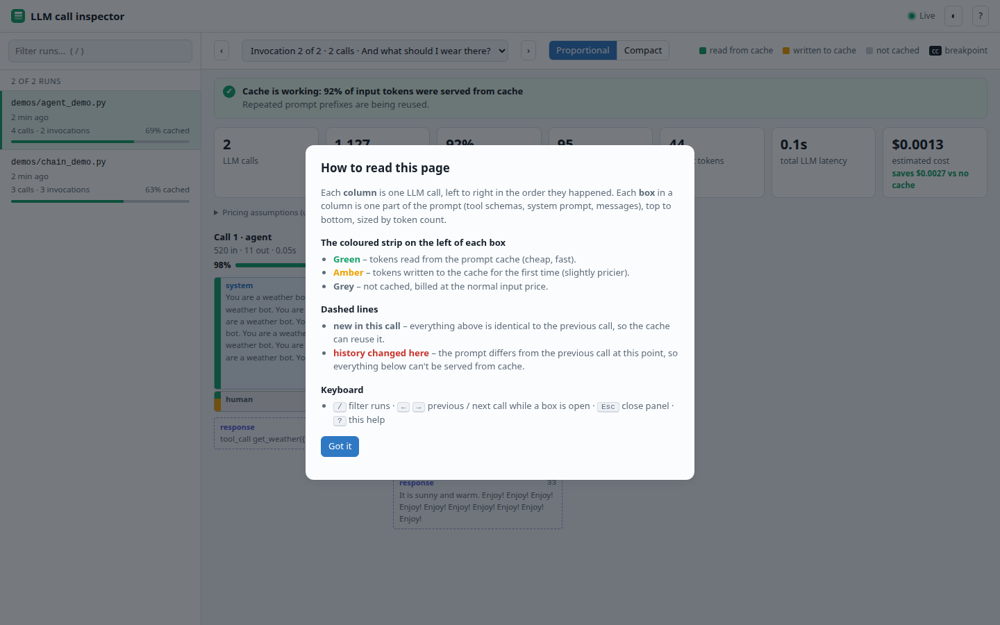
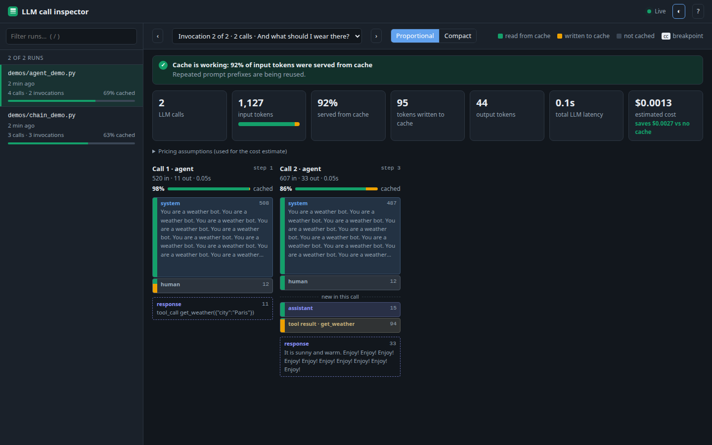

# llm_inspector

Capture LangChain / LangGraph LLM calls in-process and explore them in a web viewer: every prompt, every response, and how much of each prompt was served from the provider's prompt cache.



## Contents

- [Install](#install)
- [Usage](#usage)
- [How it works](#how-it-works)
- [A tour of the viewer](#a-tour-of-the-viewer)
- [Reading the viewer](#reading-the-viewer)
- [Keyboard shortcuts](#keyboard-shortcuts)
- [Cost estimate](#cost-estimate)
- [Try the demos](#try-the-demos)
- [Configuration reference](#configuration-reference)
- [HTTP API](#http-api)
- [Troubleshooting](#troubleshooting)
- [Layout](#layout)

## Install

```bash
python -m venv .venv && source .venv/bin/activate
pip install -e .          # requires langchain-core
```

## Usage

```bash
python -m llm_inspector run my_agent.py          # capture, no code changes
python -m llm_inspector run -m my_pkg.main       # capture a module
python -m llm_inspector serve --open             # viewer at http://127.0.0.1:8765
eval "$(python -m llm_inspector env)"            # capture any Python process (uvicorn, gunicorn, subprocesses)
```

Runs are saved to `~/.llm_inspector/runs/` (override with `LLM_INSPECTOR_DIR` or `--out` / `--dir`). The viewer updates live while a run is in progress, and `serve` does not need langchain installed.

### Commands

| Command | What it does |
| --- | --- |
| `run [--out DIR] script.py [args...]` | Runs a script with capture enabled. Arguments after the script are passed to it. |
| `run [--out DIR] -m pkg.module [args...]` | Same, for a module. |
| `serve [--dir DIR] [--host H] [--port 8765] [--open]` | Starts the viewer on `127.0.0.1:8765` by default. `--open` launches your browser. |
| `env` | Prints `export` lines that enable capture in any Python process started from your shell. |

### Capturing servers and subprocesses

`run` only covers the one process it launches. For anything else (uvicorn with `--reload`, gunicorn workers, subprocesses), enable capture through the environment:

```bash
eval "$(python -m llm_inspector env)"
uvicorn app:app --reload
```

This puts a `sitecustomize.py` on `PYTHONPATH` and sets `LLM_INSPECTOR=1`, so every Python process started from that shell records its LLM calls.

## How it works

1. `capture.install()` registers a LangChain callback handler through LangChain's global configure hook, so every chat model, chain, LangGraph node and agent is captured with no code changes.
2. Each process execution is written to one JSON file, `<run dir>/<id>.json`. The file is rewritten atomically after every LLM call, so the viewer can follow a run that is still in progress.
3. For every call it stores the prompt messages, tool schemas, the response, token usage (including cache reads and writes), latency, model, provider, and the LangGraph node and step when available.
4. Calls are grouped into **invocations**: one invocation is one top-level call of your chain, graph or agent (for example one `agent.invoke(...)`).
5. `serve` is a small dependency-free HTTP server that serves the viewer and the saved JSON files.

The recorder never raises into your application: capture errors are swallowed so the host program keeps working.

## A tour of the viewer

### 1. First launch

With no runs recorded, the viewer shows copy-able commands for capturing your first run. The page polls every few seconds, so you can leave it open and start a run in another terminal.



### 2. Run list (left sidebar)

Each recorded run shows its command, when it started, the number of calls and invocations, and the share of input tokens served from cache (also drawn as a small green bar). A green **running** badge appears while a run is still writing. Hover a run to reveal the **✕** button that deletes it. Use the filter box (`/`) to search by command or run id.



### 3. Overview of an invocation

Pick an invocation with the dropdown and the `‹` `›` buttons above the canvas. The page then shows:

- **Findings**: plain-language notes such as "Cache is working: 92% of input tokens were served from cache", "Call 3 missed the cache", "No prompt caching detected", or "N calls failed".
- **Totals**: LLM calls, input tokens (with a read / written / uncached bar), share served from cache, tokens written to cache, output tokens, total LLM latency, and estimated cost.
- **Call columns**: one column per LLM call, left to right in the order they happened.



In this example, call 2 re-sends the system prompt and the human message unchanged (green strip, read from cache), then adds an assistant message and a tool result under a **new in this call** divider. The tool result has an amber strip because it was written to the cache for the first time.

### 4. Inspecting a block

Click any box to open the detail panel on the right: the block's full content, how many of its tokens were read from cache, written, or uncached, whether it carries a `cache_control` breakpoint, and the raw message JSON. Use the `←` `→` buttons (or arrow keys) to jump to the same block in the previous or next call, and `✕` or `Esc` to close.



### 5. Inspecting a response

The dashed box at the bottom of each column is the model's response. Click it to see the full text, output token count, stop reason, latency, and the raw message JSON. If the call failed, the error is shown in its place.



### 6. Compact layout and pricing

**Proportional** sizes each box by token count; **Compact** gives every box the same small height, which is handy for long prompts. Expand **Pricing assumptions** to edit the per-million-token prices used for the cost estimate. Both settings are remembered in your browser.



### 7. Built-in help and dark mode

The **?** button (or the `?` key) opens a short reading guide. The **◐** button toggles light and dark themes; by default the viewer follows your system setting.

| Help | Dark theme |
| --- | --- |
|  |  |

The **Live** indicator in the header shows that the viewer is polling. Click it to pause, and click again to resume. It turns red and reads **Reconnecting…** if the server can't be reached.

## Reading the viewer

- Each **column** is one LLM call; each **box** is one part of the prompt (tool schemas, system, messages), sized by tokens.
- The strip on a box's left edge: **green** = read from cache, **amber** = written to cache, **grey** = not cached.
- A dashed **"history changed here"** line marks where a prompt diverges from the previous call, so the cache can't be reused below it. A **"new in this call"** line means everything above it is identical to the previous call and only content below was appended. **"history shrank"** means the prompt is a strict prefix of the previous one.
- A **cc** badge on a box means that message carries an Anthropic `cache_control` breakpoint.
- The percentage in each column header is the share of that call's input tokens read from cache.
- Plain-language findings at the top flag cache misses and failed calls. Click any box for full content.

### How per-block cache numbers are computed

Providers report cache usage once per call, not per message. The viewer walks the prompt in order (tools, system, messages), assigns the first `cache_read` tokens as hits and the next `cache_creation` tokens as writes, and treats the rest as uncached. Block sizes are estimated from text length and scaled to the reported input total. When a provider reports no token usage, sizes are estimates and are shown with a `~`.

## Keyboard shortcuts

| Key | Action |
| --- | --- |
| `/` | Focus the run filter |
| `←` `→` | Same block in previous / next call (while a box is open) |
| `Enter` | Open the focused run or box |
| `Esc` | Close the help dialog or detail panel, or leave the filter box |
| `?` | Open the help dialog |

## Cost estimate

The estimate is `uncached × input + cache_read × read + cache_creation × write + output × output price`, per million tokens, compared with the same call having no caching. Defaults are placeholders (input 3, cache read 0.3, cache write 3.75, output 15 USD per 1M tokens); edit them under **Pricing assumptions** to match your model.

## Try the demos

No API key needed; they use a fake model that simulates prompt-cache reporting.

```bash
pip install langgraph
export LLM_INSPECTOR_DIR=$PWD/.demo-runs
python -m llm_inspector run demos/chain_demo.py
python -m llm_inspector run demos/agent_demo.py
python -m llm_inspector serve --dir .demo-runs --open
```

- `demos/chain_demo.py`: a plain chain called three times with a growing conversation.
- `demos/agent_demo.py`: a LangGraph ReAct agent with one tool, invoked for two user turns.
- `demos/fake_model.py`: the offline chat model both demos use.

The screenshots in this README were taken from these demos.

## Configuration reference

| Setting | Where | Default |
| --- | --- | --- |
| Run directory (capture) | `LLM_INSPECTOR_DIR` env var or `run --out DIR` | `~/.llm_inspector/runs` |
| Run directory (viewer) | `serve --dir DIR` | `~/.llm_inspector/runs` (or `LLM_INSPECTOR_DIR`) |
| Host / port | `serve --host`, `serve --port` | `127.0.0.1` / `8765` |
| Capture any process | `LLM_INSPECTOR=1` with the `_inject` dir on `PYTHONPATH` (use `env`) | off |

## HTTP API

The viewer is a thin client over a tiny JSON API:

| Method | Path | Returns |
| --- | --- | --- |
| `GET` | `/api/executions` | Summaries of all runs, newest first (id, command, calls, invocations, token totals, hit rate) |
| `GET` | `/api/executions/<id>` | The full run JSON, including every prompt and response |
| `DELETE` | `/api/executions/<id>` | Deletes the saved run file |

Run files contain your full prompts and responses. Keep the viewer bound to `127.0.0.1` unless you understand who can reach it, since it has no authentication.

## Troubleshooting

- **The viewer says "Can't reach the inspector server"**: `serve` is no longer running, or you are on a different `--port`.
- **"cannot listen on host:port"**: the port is taken; pass `--port <other>`.
- **No runs appear**: check that `run` and `serve` use the same directory (`LLM_INSPECTOR_DIR`, `--out` and `--dir`), and that your code uses LangChain chat models (other clients are not captured).
- **"No prompt caching detected"**: the provider reported no cache reads or writes. For Anthropic models, add `cache_control` breakpoints to the stable prefix; some providers simply don't report cache usage.
- **"Call N missed the cache" with an identical prompt**: the cache may have expired (about a 5 minute TTL) or no breakpoint was set.

## Layout

```text
llm_inspector/
├── __main__.py              CLI: run / serve / env
├── capture.py               global LangChain callback hook + recorder
├── capture_dir.py           default run directory
├── server.py                dependency-free HTTP server (JSON API + viewer)
├── _inject/sitecustomize.py capture any process via PYTHONPATH
└── static/index.html        viewer UI
demos/                       offline demo agents
docs/screenshots/            images used in this README
```
